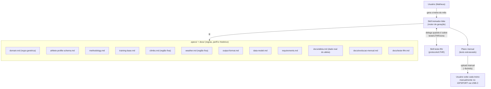

# Design de sistema — ai-coach

> Visão geral de como as peças do projeto se conectam. Arquitetura ainda leve — hoje o "sistema"
> é majoritariamente Claude Code + specs em markdown, sem código próprio ainda.

## Visão geral

```
Usuário (Matheus)
   │  "gera o treino do mês"
   ▼
Skill treinador-bike  ──lê──►  docs/atleta.md            (dados reais: perfil, rotina, zonas, saúde)
   │                            .specs/athlete-profile-schema.md (schema + onboarding, se perfil faltar/mudar)
   │                            .specs/domain.md          (regras genéricas: zona, carga, periodização)
   │                            .specs/methodology.md     (embasamento: Coggan/Allen, Friel, etc.)
   │                            .specs/training-base.md   (biblioteca de padrões de treino)
   │                            .specs/climbs.md          (subidas da região do atleta — sinal de carga)
   │                            .specs/output-format.md   (cadência mensal, formato)
   │                            docs/evolucao-mensal.md   (histórico real de carga)
   │
   ├──delega para──► Skill teste-fthr (quando o pedido é sobre teste/LTHR/zona; atualiza docs/atleta.md)
   │
   ▼
Plano mensal (texto estruturado: terça/quinta com blocos, sábado com duração, domingo como log)
   │
   ▼
Usuário sobe cada treino manualmente no iGPSPORT 200S via USB-C (~8x/mês)
```

### Diagrama (Mermaid)



## Componentes atuais

- **`.specs/*.md`** — a fonte da verdade das **regras genéricas** do domínio (não de dado
  específico de pessoa). Tratado como dado, não como código: a skill lê esses arquivos toda vez
  que precisa decidir algo. `.specs/athlete-profile-schema.md` é o schema/onboarding do perfil.
- **`docs/atleta.md`** — os **dados reais** do atleta atual (instância do schema acima): perfil,
  zonas vigentes, rotina semanal, restrições de saúde. Separado de `.specs/` de propósito, para
  `domain.md` poder ser reutilizado por outro atleta/perfil sem reescrever regra.
- **`.claude/skills/treinador-bike/`** — o "motor" de geração de treino. Orquestra as regras de
  `.specs/` + os dados de `docs/atleta.md` e produz o plano mensal; roda o onboarding quando o
  perfil falta ou está desatualizado.
- **`.claude/skills/teste-fthr/`** — sub-rotina especializada em teste/calibração de LTHR, usada
  pelo treinador-bike quando o assunto é teste de FC limiar.
- **`docs/*.md`** — dados históricos reais (evolução mensal, testes de FTHR) e decisões (ADRs).
  Não são regra, são fato/registro.

## Modelo de dados

Ver `.specs/data-model.md` para as entidades (Atleta, ZonaFC, TesteFTHR, Subida,
TreinoEstruturado, SemanaTreino, PlanoMensal, HistoricoMensal) e como se relacionam.

Hoje esse modelo é conceitual — não há banco de dados nem persistência própria; o "estado" vive
nos arquivos markdown (specs + docs) e na conversa com o Claude Code.

## Evolução futura

- **Interface web**: **decidido** — Nuxt 3 (Vue + TypeScript), sobre Vite/Node (ver `docs/decisions.md`). Vai exibir o plano mensal gerado pela skill; acesso também resolve o caso de uso mobile via navegador.
- **App mobile**: **decidido** — React Native/Expo, publicado via EAS Update (tier grátis) e acessado pelo app Expo Go, sem precisar de App Store/Google Play (ver `docs/decisions.md`).
- **Exportador de arquivo pro dispositivo de treino** (hoje: iGPSPORT 200S, ver `docs/atleta.md`):
  gerar arquivo compatível a partir do plano mensal, para reduzir o trabalho manual de criar cada
  treino (hoje: 100% manual via USB-C, ~8x/mês).
- **Persistência**: se/quando sair do modelo "specs em markdown lidas pela skill" para uma
  aplicação de verdade, decidir onde os dados do modelo em `.specs/data-model.md` vão morar
  (arquivo local, banco simples, etc.) — sem necessidade disso enquanto o uso for só via Claude Code.

Essas decisões ficam em aberto de propósito — resolver quando o desenvolvimento começar de fato,
não antes.
